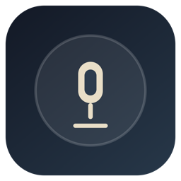
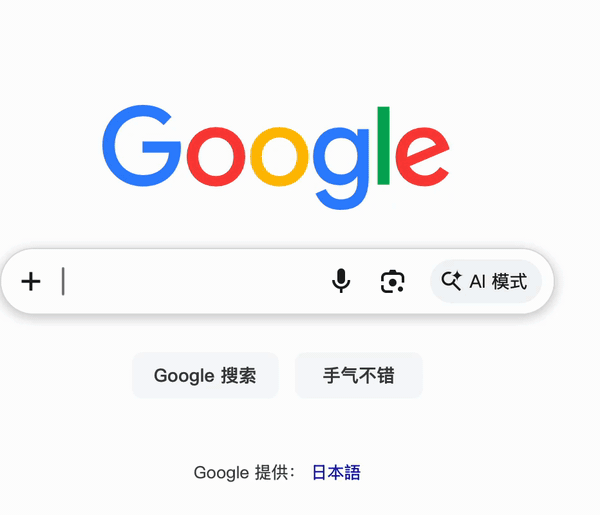

English | [中文](README.zh-CN.md)

<p align="center">
  
</p>

# Friday

[](https://github.com/FlyingFSR/friday/actions/workflows/ci.yml)
[](https://github.com/FlyingFSR/friday/releases/latest)
[](LICENSE)
[](#requirements)

**Local-first macOS dictation built for mixed Chinese-English speech (中英混说).**
Hold a key, speak, release — your words are transcribed on-device by Alibaba's
[Qwen3-ASR](https://huggingface.co/Qwen/Qwen3-ASR-1.7B), running inside the app on
Apple's [MLX](https://github.com/ml-explore/mlx-swift), and pasted straight into
whatever app you're using. No cloud, no account, no telemetry, and no audio
leaving your Mac.

<p align="center">
  
</p>

> Friday lives in your menu bar and stays out of the way until you hold the
> hotkey. It's built for people who want to dictate without sending their voice
> to someone else's server.

<p align="center">
  <a href="https://github.com/FlyingFSR/friday/releases/latest"><b>⬇&nbsp; Download the latest release</b></a><br>
  <sub>Unsigned preview build — first launch needs the <a href="#install-download">Open Anyway</a> step. Or <a href="#development">build from source</a>.</sub>
</p>

## Features

- **Mixed-language dictation** — the reason Friday exists. Speech that switches
  between Chinese and English in the same breath stays intact, with brand and
  tech-term biasing plus cleanup. On the maintainer's 41 evaluation recordings,
  0.5.0's Qwen3-ASR engine made fewer errors than 0.4.0's Whisper Medium
  (Chinese character error rate 2.0% -> 1.2%, English word error rate 2.2% ->
  1.3%) and answered faster (median about 1.6 s -> 0.6 s); see
  [Known Limitations](#known-limitations).
- **Fully on-device** — transcription by Qwen3-ASR inside the app; audio never leaves your machine.
- **Configurable push-to-talk** — choose Right/Left Command, Right/Left Option,
  or Right Control; hold to record and release to transcribe. Right Command
  remains the default.
- **Paste anywhere** — text is inserted at your cursor, with clipboard restore afterward.
- **Secure-input aware** — automatically refuses to paste into password fields and other protected contexts.
- **First-run onboarding** — guided setup for permissions and model download.

## Requirements

- Apple Silicon Mac (macOS 14+), with about 2.3 GB of memory to spare while
  Friday runs
- **Downloaded release builds need nothing extra** — the app downloads its speech
  model (about 2.2 GB) during first-run setup.

## Install (download)

1. Download the latest zip from
   [Releases](https://github.com/FlyingFSR/friday/releases/latest) and move
   `Friday.app` to your Applications folder.
2. Current release zips are unsigned preview builds, so on a clean Mac the first
   launch shows "Apple could not verify Friday" and only offers **Done** or
   **Move to Trash**. Click **Done**.
3. Open **System Settings** -> **Privacy & Security**.
4. In **Security**, click **Open Anyway** for Friday.
5. Confirm **Open Anyway** again, then enter the administrator password.

This workaround is only for early tester builds. Public releases should move to
Developer ID signing and notarization before claiming normal double-click
installation.

On first launch, grant the three permissions macOS requires for a voice-input
tool:

1. **Microphone** — to capture your speech
2. **Accessibility** — to paste into other apps
3. **Input Monitoring** — to detect the push-to-talk hotkey

Then install the **Qwen3-ASR 1.7B** model, choose a push-to-talk key in
the menu bar or setup assistant, and try it: hold the selected key, speak,
release.

## Models

- Friday ships a single transcription model: **Qwen3-ASR 1.7B, 8-bit**
  (Apache 2.0, Alibaba Qwen team), about 2.2 GB.
- It downloads to `~/Library/Application Support/Friday/models/qwen3-asr-1.7b-8bit/`
  from a pinned Hugging Face revision, and every file is checked against a
  SHA-256 value computed from our own 8-bit conversion of Alibaba's official
  checkpoint; anything that does not match is rejected.
- The language is always set (Chinese, unless you choose English). Left to detect
  the language itself, Qwen3-ASR translated Chinese inside mixed dictation into
  English; set to Chinese, it still writes English sentences in English.
- Upgrading from 0.4: the Whisper Medium file is left in place and 0.4's settings
  file is not rewritten, so going back to 0.4 needs no download or repair.

## Known Limitations

Friday is early software. A few things are intentionally honest about their
current state — the short version is here, the full version with measurements and
reasoning is in [docs/LIMITATIONS.md](docs/LIMITATIONS.md).

- **Mixed-language edge cases.** On 50 short "one sentence Chinese, one sentence
  English" recordings, every second sentence survived and none was translated.
  All testing so far is one speaker in a quiet room — not a general benchmark;
  other voices and noisy places are untested.
- **No terminal punctuation.** Smart cleanup (the default) deliberately strips a
  sentence-ending period or question mark: a mark the model produced is a guess
  about your intent, and a wrong guess is worse than none. Punctuation inside the
  utterance is preserved.
- **Unsigned builds, Apple Silicon only.** Release zips are not yet signed or
  notarized, so first launch needs the **Open Anyway** flow. macOS 14+ on Apple
  Silicon; there is no Intel build.
- **Memory.** The model stays loaded while Friday runs: about 2.3 GB resident,
  more while transcribing a long recording (0.4's Whisper used about 1 GB).
- **Opinionated text cleanup.** Friday rewrites words that sound like AI tools
  ("cloud" -> "Claude", "codec" -> "Codex", and more) in **all** cleanup modes,
  with no off switch yet — which means some ordinary English words get replaced
  too. It also strips Korean and Japanese character runs (a filter kept from the
  Whisper era), so Friday is currently unsuitable for dictating those languages. A
  user-configurable vocabulary list is planned.

[Read the full list](docs/LIMITATIONS.md) before filing an issue — several of
these are deliberate.

## Privacy

Friday is local-first by design. Your audio is transcribed on your own machine
and is never uploaded, logged remotely, or sent to any third party. Model files
are downloaded directly from their source the first time they're needed.

## Development

Building from source works with the Command Line Tools alone (no Xcode). Build
with `--build-system native`, which skips MLX's Metal sources, and fetch the
matching prebuilt Metal shader library (Apple's official `mlx-metal` package on
PyPI, pinned by checksum):

```bash
swift build --build-system native              # build
swift test --build-system native               # run tests
bash scripts/fetch-mlx-metallib.sh --dev       # shader library next to the binaries
.build/debug/FridayMac                         # run
```

First launch from source needs the same three permissions and the same model
setup as a downloaded build — see [Install (download)](#install-download).

If the menu bar state ever looks stale, do a clean restart:

```bash
pkill -f FridayMac || true
swift build --build-system native
.build/debug/FridayMac &
```

### Install as an app from source

Build, install, and launch `Friday.app` in one step:

```bash
bash scripts/install-local-app.sh
```

- Installs to `/Applications/Friday.app` (falls back to `~/Applications` if needed)
- Launchable by double-clicking in Finder
- Idempotent — cleanly replaces a previous install

Build the bundle only, without installing:

```bash
bash scripts/build-local-app.sh
# Output: dist/Friday.app
```

### Distributing a signed build

To install on another Mac without "unverified developer" warnings, use a
Developer ID signature + Apple notarization.

Store notary credentials once (saved in your Keychain):

```bash
FRIDAY_APPLE_ID="you@example.com" \
FRIDAY_TEAM_ID="ABCD123456" \
FRIDAY_APP_PASSWORD="xxxx-xxxx-xxxx-xxxx" \
bash scripts/store-notary-credentials.sh
```

Build a signed + notarized DMG:

```bash
FRIDAY_SIGN_IDENTITY="Developer ID Application: Your Name (ABCD123456)" \
FRIDAY_NOTARY_PROFILE="FridayNotary" \
bash scripts/release-signed-notarized-dmg.sh
# Output: dist/Friday.dmg
```

The recipient still grants microphone / accessibility / input-monitoring
permissions on first run — that's a macOS security requirement, not optional.

See [CONTRIBUTING.md](CONTRIBUTING.md) for how to get involved.

## Background

Friday started as a private macOS prototype for a very ordinary reason: I wanted
to dictate notes, prompts, and code-adjacent text without sending my voice to a
cloud service or changing the app I was already working in. I speak Chinese and
English in the same sentence all day, and nothing local handled that well.

The public repository is young, but the project is not a one-day demo. Before
opening it up, Friday went through several months of daily-use iteration: the
menu bar app shell, hold-to-talk recording, paste-and-restore behavior,
permission onboarding, secure-input checks, local model management, mixed
Chinese/English cleanup, VAD experiments, and the move from a development-only
whisper setup to a bundled `whisper-server` release package. In 0.5 the speech
engine itself changed, from whisper.cpp to Qwen3-ASR running inside the app.

That history is also why the README is intentionally specific about limitations.
Friday already works well enough to be useful, but it is still early public
software: unsigned preview releases, rough mixed-language edge cases, and some
keyboard-compatibility work remain.

It's open source because a local-first voice input tool is something people
should be able to inspect, adapt, and trust. Issues and pull requests are
welcome, especially from people testing it on real Macs and real dictation
workflows.

## Related projects

Other open-source tools by the same author:

- [critical-second-pass](https://github.com/FlyingFSR/critical-second-pass) — a
  Codex skill for an honest, harder second read of a plan, diff, or draft.
- [conversation-archive](https://github.com/FlyingFSR/conversation-archive) — a
  skill for AI assistants that turns conversations into structured archives that
  keep their texture, not just their text.

## License

[MIT](LICENSE) © Friday Mac contributors
